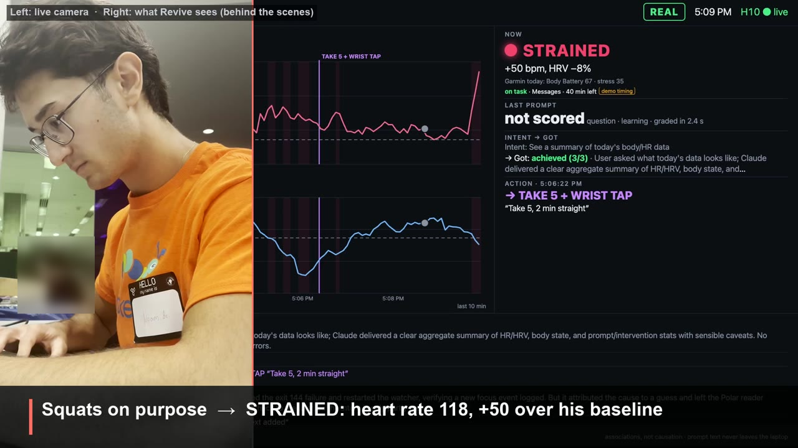
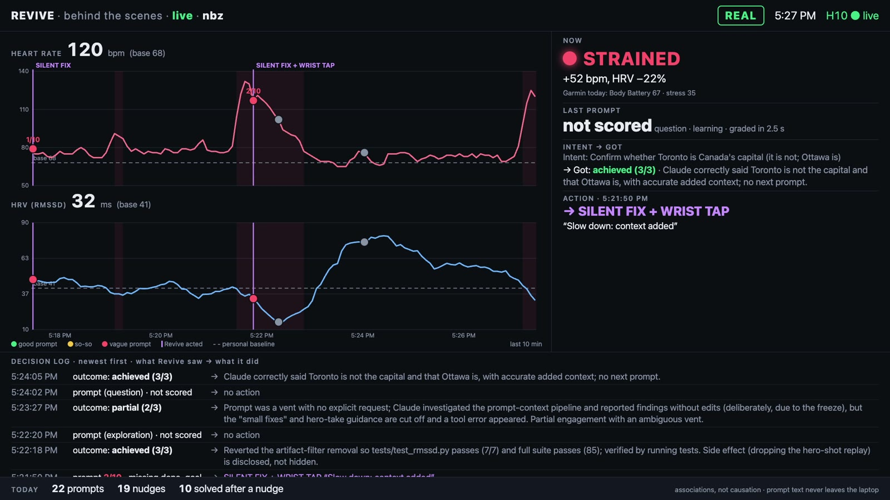
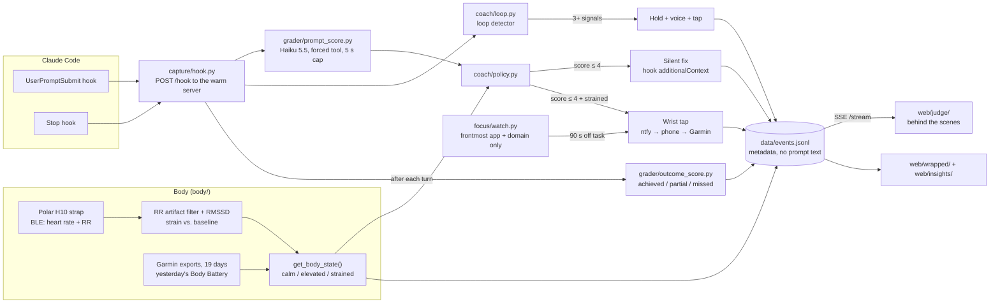

# Revive

**Your body knows you're about to waste an hour with AI. Revive taps your wrist first.**

Revive joins a Polar H10 heart strap with your Claude Code session. Claude Code hooks grade every prompt with Claude Haiku 5.5 before Claude answers. When a vague prompt meets a strained body, Revive quietly adds the missing context to the prompt and buzzes your Garmin. No app to open: Revive acts through a wrist tap, the Mac's voice or added context. The live screen is a judge view labeled "behind the scenes", plus an AI Wrapped card and an insights page that summarize the log.


<sub>5:09 PM, live. Left: the camera on Noam after squats. Right: the judge view reading the strap: STRAINED, +50 bpm. The action on screen is the focus watcher's "Take 5" tap (demo timing). The prompt tap is in the second screenshot below.</sub>

**Demo video (1:35):** linked in the c0mpiled-16 submission (YouTube) · **Built** Sat Oct 24, 2026, 1:45–6:30 PM at c0mpiled-16 (UCSD) · **Team** Lucas Bicudo, Noam Ben-Zion

**Worn while we built it:** 110 prompts captured, 21 nudges, 13 wrist taps, 10 solved after a nudge ([pitch/today_numbers.json](pitch/today_numbers.json)) · 85 tests passing.

## What it does
- **Vague prompt → silent fix.** Before Claude replies, Claude Haiku 5.5 scores the prompt 0–10 (context, done check, goal, scope, why). At 4 or below, the hook adds what's missing through `additionalContext`: if context is missing, the last error from the last two turns (including a failing test you ran with `!`) and the files you just edited; if the done check is missing, a line asking Claude to run the test and say how it verified the fix. It adds to the prompt; it never rewrites it.
- **Vague prompt + strained body → wrist tap.** The strap streams heart rate and RR intervals over Bluetooth. If heart rate is 20+ bpm over baseline or RMSSD (HRV) is under 60% of baseline, the same vague prompt also buzzes the Garmin: "Slow down: context added" (ntfy → phone → watch). At most one tap per 20 minutes.
- **Looping or drifting → hold, voice or tap.** If you keep retrying the same thing (3+ loop signals in 15 min), the hook holds the prompt, the Mac says "You're looping. Take two minutes." and the wrist gets "Looping: take 2". A focus watcher taps "Back to task, 45m left" (the minutes left in your work block) after 90 s on a distraction site and "Take 5" after 90 minutes without a break.

You never open anything. Whoop sees the body and Anthropic sees the prompts; Revive joins the two on your own laptop and acts in the moment.

## The moment
1. Noam does squats next to the laptop. The strap reads strained: heart rate well above baseline, HRV down.
2. A test is red. Noam types `hrv is broken fix it`.
3. Revive scores it 2/10, missing the done check and the goal. Vague + strained → **silent fix**: the hook adds what's missing, here a line asking Claude to run the test and say how it verified the fix. **Wrist tap**: "Slow down: context added".
4. Claude restores the filter and the test goes green. The judge view shows each step in the decision log.


<sub>The judge view on Noam's laptop at 5:27 PM, during the hero takes. The ACTION panel is the 5:21:50 PM take: a 2/10 prompt (missing the done check and the goal) while strained → silent fix + wrist tap. The next outcome, at 5:22:18, is achieved: the filter is restored and `tests/test_rmssd.py` passes. The footer counts only this laptop's log at 5:27 PM; totals for both laptops are under [The numbers](#the-numbers).</sub>

The bug is real: we hit it at 11:30 AM, and today's squat recording reproduces it (RMSSD 99 ms unfiltered vs. 17 ms filtered). The takes start from the git tag `hero-red`, which is `demo-final` plus one commit that removes the RR artifact filter ([see the diff](https://github.com/Mistygoober/revive/compare/demo-final...hero-red)). The squats and the lazy prompt are staged, and we say so in the video.

## How it works

- **Body** (`body/`): reads the Polar H10 live over Bluetooth. Strain is judged against a resting heart rate of 68 bpm (set in [body/polar.py](body/polar.py)) and an RMSSD of 41 ms, the daytime strap value. The median resting heart rate in 19 days of Noam's Garmin exports is 69 bpm (18 days had a reading; [body/baselines_nbz.json](body/baselines_nbz.json)); wiring it into the live label is a TODO. If no reading is newer than 15 s (for example, a laptop without the strap), it falls back to `FAKE_STRAIN`, labeled `source: "fake"`, and every action taken on it is logged `demo: true`.
- **Grader** (`grader/`): two checks per turn. Before Claude replies, a prompt score 0–10 (rubric in [docs/plan/grader-rubric.md](docs/plan/grader-rubric.md)). After the turn, from the `Stop` hook, an outcome (achieved / partial / missed / wrong direction) plus the intent it inferred. If the API call takes over 5 s, it falls back to a keyword heuristic ([grader/_llm.py](grader/_llm.py); raised from 3 s after a hotspot test fell back). The hook waits up to 9 s for the server ([capture/hook.py](capture/hook.py)).
- **Coach** (`coach/`): score ≤ 4 → silent fix. Score ≤ 4 and strained → silent fix + wrist tap, at most once per 20 minutes. A poor night (under 6 h of sleep or Body Battery under 40) makes it step in at ≤ 5. Yesterday's Garmin export (Oct 23) had no sleep data and a Body Battery high of 67, so the normal threshold applied.
- **Judge view** (`web/judge/`): live heart rate and HRV, prompt scores, outcomes and every coach decision, pushed from the event log. Only judges see it.

## Technical highlights
- **Bluetooth heart data, decoded by hand.** [body/polar.py](body/polar.py) subscribes to the standard Heart Rate Measurement characteristic (0x2A37) with bleak and parses the flags byte itself: 8- or 16-bit heart rate, the energy-expended field skipped, RR intervals in 1/1024 s. A garbled packet returns nothing instead of raising.
- **An RR artifact filter that fixes a real bug.** [body/rmssd.py](body/rmssd.py) drops RR intervals outside 300–2000 ms and any beat more than 20% off the median of the last 10 accepted beats. It computes RMSSD only across beats that were adjacent in the original stream, never across a removed artifact. On today's real squat recording ([fixtures/squats_rr.jsonl](fixtures/squats_rr.jsonl), 64 RR intervals), RMSSD reads 99 ms unfiltered vs. 17 ms filtered; [tests/test_rmssd.py](tests/test_rmssd.py) pins it.
- **Hooks that add context instead of rewriting.** [capture/hook.py](capture/hook.py) runs on `UserPromptSubmit` and `Stop` ([.claude/settings.json](.claude/settings.json)). It is a thin client: it POSTs to the warm server (`POST /hook`) and runs in-process if no server answers. It never blocks a normal prompt or crashes the session. The silent fix ([coach/context.py](coach/context.py)) reads the session transcript and returns `additionalContext` of at most 1,500 characters.
- **A forced-tool Haiku grader with a hard deadline.** [grader/_llm.py](grader/_llm.py) makes one call to Claude Haiku 5.5 with `tool_choice` forced, a 5 s wall-clock cap and no retries. Any timeout, API error or missing key falls back to a keyword heuristic, logged `source: "heuristic"`. The rubric scores context 0–3, done 0–3, goal 0–2, scope 0–1 and why 0–1. It ignores length and never sees heart data, so "strained → lower score" can't be built in.
- **Checked against a human.** [grader/calibration/](grader/calibration/): on 10 made-up prompts that Lucas scored before seeing the grader, 7 of 10 agree: 4 of the 7 scored prompts are within 1 point of Lucas's score, and the grader correctly left 3 questions or confirmations unscored (Lucas rated them fine). 5 of the 7 scored prompts are within 2 points.
- **Outcome scoring after every turn.** The `Stop` hook grades the turn and infers the intent ([grader/outcome_score.py](grader/outcome_score.py), [coach/outcome.py](coach/outcome.py)). The server runs it as a background task, so Claude Code isn't kept waiting ([server.py](server.py)).
- **Loop detector.** [coach/loop.py](coach/loop.py) looks for retry prompts, the same error twice, frustration, and no passing test or commit. 3+ signals in 15 minutes plus a retry streak → hold the prompt, speak (Mac `say`) and tap. It is unit-tested but never fired live today (0 loops in the logs).
- **Live judge view over SSE.** `/stream` in [server.py](server.py) tails `data/events.jsonl` and pushes each new line as a server-sent event. [web/judge/](web/judge/) is vanilla JS + canvas, with a DEMO DATA badge whenever demo events, replayed or fake body state are on screen.
- **Stats you can check.** [history/validity.py](history/validity.py) computes Spearman ρ, permutation p-values and Cliff's δ on 239 scored past prompts. [scripts/check_predictions](scripts/check_predictions) scores the predictions we locked before writing any code as TRUE / FALSE / NOT ENOUGH DATA, with n.
- **Tests and a pre-demo check.** 85 tests (`uv run pytest -q`, about 8 s), each on a temporary event log ([tests/conftest.py](tests/conftest.py)). [scripts/demo_check](scripts/demo_check) pushes one vague prompt and one Stop through the real hook and prints PASS/FAIL per event.

## The numbers
**On Lucas's own past Claude Code prompts** (Oct 17–24: 665 typed prompts, 53 dropped by a confidentiality filter, 612 graded, 239 real asks scored):
- Higher prompt scores are **associated with** fewer turns to done (Spearman ρ = −0.24, p = 0.003, n = 170) and a higher achieved rate (ρ = +0.23, p = 0.001, n = 229).
- Bottom vs. top third of scores (≤ 2, n = 60, vs. ≥ 4, n = 48): **1.8 vs. 1.27 turns to done (1.42×, permutation p = 0.034, Cliff's δ 0.24)**; achieved 45% vs. 73% (n = 83 vs. 56, p = 0.0007).
- This was the second cut we tried; the first (buggy) cut gave 1.24×, p = 0.095. The pre-registered split (≤ 4 vs. ≥ 7) is underpowered: only 3 prompts scored ≥ 7 (1.23×, p = 0.82).
- The done and goal checks carry the signal (|ρ| ≈ 0.25–0.29); context, as graded here, carries none (ρ ≈ 0).
- No association between time of day and prompt score (ρ = 0.03).

Source: [history/results.json](history/results.json), summary in [history/SUMMARY.md](history/SUMMARY.md). One person, one week, observational. Caveats in [DEMO_NOTES.md](DEMO_NOTES.md#validity-caveats-from-historysummarymd).

**Today, built and worn at the event** (both laptops' event logs, 1:45–5:41 PM, demo events excluded; the logs are git-ignored, the aggregates are committed): **110 prompts captured, 21 nudges, 13 wrist taps, 10 solved after a nudge.** The 21 nudges are 13 silent fixes (5 of them with a wrist tap, each on a vague prompt while the strap read strained) and 8 focus-watcher taps (run with demo timing: 20 s / 2 min). "Solved after a nudge" means the next outcome was achieved. Counts and definitions: [pitch/today_numbers.json](pitch/today_numbers.json).

**Predictions** (written 12:11 PM, before any code, locked at 12:13: [pitch/predictions.md](pitch/predictions.md)). Checked at 5:34 PM by [scripts/check_predictions](scripts/check_predictions) → [pitch/predictions_result.json](pitch/predictions_result.json), demo events excluded:

| Prediction (locked) | Result |
| --- | --- |
| 1. Our prompts get worse as the day goes on (last build hour ≥ 1 point below the first) | **Not enough data.** The hooks landed at 2:41 PM, so the first hour has 1 scored prompt (avg 2.0). Last hour: avg 2.29, n = 35. |
| 2. When Noam is strained, prompts need ≥ 1.3× the turns or reach "achieved" less often (≥ 5 per group) | **True by the pre-set rule, on a tiny sample:** achieved 60% strained vs. 86% calm (n = 5 vs. 7). Turns to done 3.0 vs. 2.67 (1.12×, under the 1.3× bar). No significance test, so we don't read much into it. |
| 3. At least 2 of every 3 loops start after the 3:30 gate | **Not enough data:** 0 loops detected live today. |
| Main validity check: low scores (≤ 4) reach "achieved" less often than high (≥ 7) | The direction holds (46% vs. 67%), but only 3 prompts scored ≥ 7, so p = 0.60: not shown. The bottom-vs-top-third split above is the post-hoc check that does show it. |

## What's real and what's replayed
- **Live:** the strap (heart rate + RR → RMSSD), the hooks, the grader, the silent fix, the wrist tap, the focus watcher, the judge view and its decision log.
- **Staged:** the squats, the lazy prompt and the planted bug in the hero take.
- **Replayed from git:** the bug, a real one from 11:30 AM (tag `hero-red`), on real squat data recorded today.
- **Demo timing:** the focus watcher ran at 20 s / 2 min instead of 90 s / 90 min, tagged on every event.
- **Built but not seen live:** the loop hold (0 loops today).
- **DEMO DATA:** seeded events and fake or replayed body state are badged on screen.

Full table and known weak spots: [DEMO_NOTES.md](DEMO_NOTES.md).

## Privacy
- Body data and raw prompts stay on the laptop. Raw prompt and reply text is kept in `memory/raw/`, which is git-ignored.
- The event log never stores prompt or reply text: lengths, scores and actions, plus the grader's one-line inferred intent and reason (shown in the judge view).
- Prompts are sent to the Anthropic API for grading; they were Claude prompts already.
- The wrist tap sends a fixed short phrase to ntfy.sh, nothing else.
- The focus watcher keeps the frontmost app and the site's domain, never page titles or full URLs.
- The repo holds aggregates only. Past prompts that named a customer were filtered out before grading, with a blocklist kept outside the repo.

## Run it
### Try it in 2 minutes (no strap, no watch)
```bash
uv sync
uv run pytest -q                                       # 85 tests, ~8 s; 4 call the live API and skip without a key
uv run uvicorn server:app --port 8000                  # then open http://localhost:8000/web/judge/
uv run python scripts/fake_events.py --fast            # in a second terminal: ~18 s scripted replay, badged DEMO DATA
DEMO_MODE=1 uv run python -m body.polar --no-filter    # replay the real squat trace without the filter: the hero bug (Ctrl-C to stop)
uv run python -m grader.prompt_score "hrv is broken fix it"   # Haiku with REVIVE_ANTHROPIC_KEY, keyword heuristic without
```

### The full setup
```bash
cp .env.example .env    # then fill in REVIVE_ANTHROPIC_KEY and NTFY_TOPIC yourself; keys live only in .env
uv run uvicorn server:app --host 0.0.0.0 --port 8000
uv run python -m body.polar                            # live Polar H10 reader
uv run python -m focus.watch --minutes 45              # optional: focus watcher for a 45-minute block
scripts/demo_check                                     # one vague prompt + one Stop through the real hook, PASS/FAIL
```
- Judge view: http://localhost:8000/web/judge/
- Hooks load automatically when you start Claude Code in this folder (`.claude/settings.json`). Start a fresh `claude` session inside the repo; a session opened before the repo existed never loads them. Set `REVIVE_WHO=nbz` on the laptop that should tap the wrist.
- Without the strap: `FAKE_STRAIN=strained` in `.env` (labeled fake, badged DEMO DATA).
- History numbers: `uv run python -m history.validity` (needs Lucas's past Claude Code sessions and the private grade cache; neither is in the repo).

## Built in one afternoon
Sat Oct 24, 2026, c0mpiled-16 at UCSD. The plan docs ([docs/plan/](docs/plan/)) and the predictions were written before 1:45 PM; no product code before then.

| | |
| --- | --- |
| Commits during the event | 42 on main (Lucas 35, Noam 7), from 2:15 to 5:46 PM |
| Code | about 5,060 lines of Python, JS, CSS, HTML and scripts, plus about 960 lines of tests |
| Tests | 85 passing in about 8 s (`uv run pytest -q`) |
| Tags | `hero-bug` (Noam's real squat recording + the test that pins it) · `demo-final` (the freeze) · `hero-red` (`demo-final` plus one commit that removes the RR filter, so the hero take starts red) |
| Worn live | 110 prompts captured, 21 nudges, 13 wrist taps, 10 solved after a nudge |
| Video | 1:35, captions burned in |

Timeline from the commit log: hooks at 2:41 PM, grader at 2:46, the fast `POST /hook` path at 3:03, the live H10 reader at 3:16, Garmin baselines at 3:55, the focus watcher at 3:58, the loop detector at 4:03, the 5 s grader cap at 4:55.

## Built with Claude Code
- Revive runs on Claude Code's own hooks, and it graded our own prompts while we built it (110 captured today).
- [.claude/settings.json](.claude/settings.json): the two hooks, plus deny rules that block Claude's Read and Edit tools on `.env`.
- [.claude/agents/demo-reviewer.md](.claude/agents/demo-reviewer.md): a review agent that checks each diff for leaked secrets, raw health data, notifications to anyone else, and causal claims where only an association was measured.
- [CLAUDE.md](CLAUDE.md): the working rules (one step at a time, DEMO DATA labels, "associated with").

## Repo map
| Folder | What's in it |
| --- | --- |
| [capture/](capture/) | the Claude Code hook (`hook.py`) |
| [grader/](grader/) | Haiku prompt and outcome scoring, heuristic fallback, calibration |
| [coach/](coach/) | when to step in (`policy.py`), the silent fix (`context.py`), the loop detector, outcome wiring |
| [body/](body/) | Polar H10 reader, RR filter + RMSSD, strain, Garmin baselines |
| [act/](act/) | wrist tap (ntfy) and the Mac voice |
| [focus/](focus/) | focus watcher: distraction and break taps |
| [history/](history/) | validity study on Lucas's past prompts (aggregates only) |
| [web/](web/) | judge view (live), AI Wrapped card, insights page |
| [fixtures/](fixtures/) | Noam's real H10 squat recording, used for replay and the hero-bug test |
| [scripts/](scripts/) | `demo_check`, `check_predictions`, `fake_events.py` |
| [pitch/](pitch/) | video script, runbook, predictions, today's numbers, submission |
| [docs/plan/](docs/plan/) | the plan, written before the build |

## Team
- **Lucas Bicudo** – the Claude side: hooks, grader, coach, loop detector, focus watcher, history numbers, judge view.
- **Noam Ben-Zion** – the health side: Polar H10 reader, RR filter + RMSSD, wrist tap and voice, Garmin exports, the real squat recording; live subject in the video.

## What's next
- **Agents over per-person memory:** a health agent, a Claude-usage agent, a combined agent that joins the two, short-term and long-term memory agents, and a researcher that proposes small personal experiments.
- **Two kinds of memory, kept apart:** raw facts (`memory/raw/`, never altered) and generated insights (`memory/insights/`, always labeled as generated).
- Run the loop hold on a real session (built and unit-tested, never triggered today), wire the 19-day Garmin heart-rate baseline into the live strain label, and add more devices.

## License
[MIT](LICENSE)
